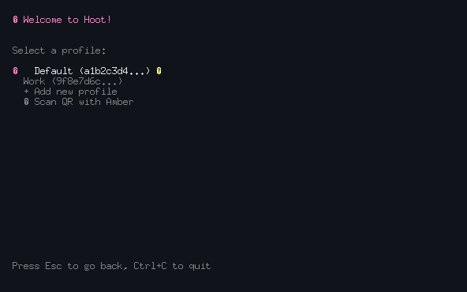
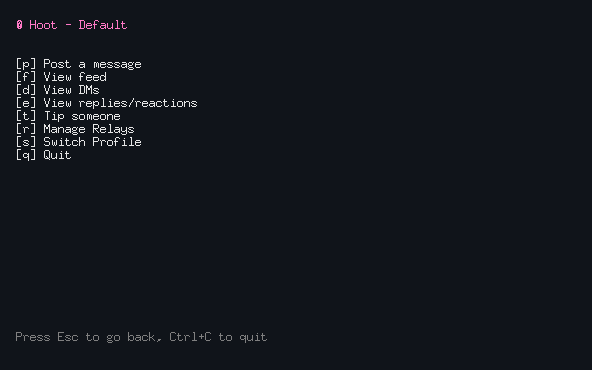
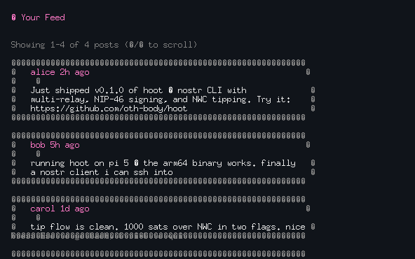

# hoot - a Nostr client for your terminal

Post notes, read the feed and your DMs, and tip people in sats from the command line. Run `hoot` for a full-screen TUI, or use flags (`hoot -m "gm"`) for scripts. It's a hobby project, made for fun.

📖 **Full documentation: https://hoot-docs.vercel.app**

## Features

- **Two ways to sign in**: import an `nsec` (encrypted locally with your password), or scan a QR code with [Amber](https://github.com/greenart7c3/Amber) so your key stays on your phone (NIP-46)
- **Multiple accounts**: save several profiles and switch between them
- **Post** notes to all your relays at once
- **Read** the global feed, your encrypted DMs (NIP-04), and replies/reactions to any note
- **Tip in sats** by Lightning address or npub through any Nostr Wallet Connect wallet (NIP-47). Hoot waits for the wallet to confirm, and refuses invoices for the wrong amount.
- **Manage relays** in the app, even before signing in
- **NIP-89** app-handler commands

## Screenshots

<p align="center">
  
  
</p>
<p align="center">
  
</p>

## Install

Download a prebuilt binary for Linux, macOS or Windows from [Releases](https://github.com/oth-body/hoot/releases), or build from source with **Go 1.26+**:

```bash
git clone https://github.com/oth-body/hoot.git
cd hoot
go build -o hoot .
sudo mv hoot /usr/local/bin/   # optional (Linux/macOS)
```

## Quick Start

```bash
hoot                                   # open the TUI: add a profile or scan with Amber
hoot -m "Hello Nostr! #introduction"   # post from the command line
hoot -nwc "nostr+walletconnect://..."  # connect a wallet (once)
hoot -tip 21 -user alice@getalby.com   # send a tip
```

In the TUI: **↑/↓** or **j/k** to move, **Enter** to select, **Esc** to go back, **Ctrl+C** to quit.

## Usage

### TUI

Run `hoot` with no arguments. From the home screen you can post, view the feed, view DMs, look up replies and reactions to a note, tip someone, manage relays, and switch profiles.

Signing in with Amber: choose **Scan QR with Amber** and scan the code with the Amber app. Your name, NIP-05 and bio from your Nostr profile appear on the home screen. Reading DMs isn't supported with Amber yet.

### CLI

The CLI uses the key stored with `hoot -s -k <nsec>` if there is one, otherwise the TUI profile you last used. It prompts for the password, or reads it from `HOOT_PASSWORD`.

| Flag | Description |
| ---- | ----------- |
| `-m "text"` | Post a note (`#hashtags` become `t` tags) |
| `-r "url1,url2"` | Relays to use for `-m` / `-u` instead of your saved list |
| `-l` | Show your last 4 notes |
| `-p` | Show your profile (kind 0) JSON |
| `-u '<json>'` | Publish a new profile. **Replaces the whole profile**, so include every field (start from `hoot -p`) |
| `-dms` | Show your DMs |
| `-replies <hex-event-id>` | Show replies/reactions to a note |
| `-s -k <nsec>` | Store a private key, encrypted with a password |
| `-nwc "uri"` | Save your Nostr Wallet Connect connection string |
| `-tip <sats> -user <who>` | Tip a Lightning address, npub or hex pubkey |
| `-register-handler "kinds"` | NIP-89: announce a handler app (with `-url-template`, `-platform`) |
| `-recommend "pk:d:kind"` | NIP-89: recommend a handler app |
| `-find-handlers <kind>` | NIP-89: list handler apps for a kind |
| `-version` | Print version info |

See the [CLI reference](https://hoot-docs.vercel.app/cli-reference/) for details and examples.

### Tipping

1. In your wallet (e.g. Alby Hub), create an app connection that can send payments and copy its `nostr+walletconnect://` string.
2. `hoot -nwc "<that string>"`
3. Tip from the TUI (**[t] Tip someone**) or with `hoot -tip <sats> -user <who>`.

Hoot waits up to 60 seconds for the wallet's confirmation. If it times out, the payment may still complete, so check your wallet before retrying. More in the [tipping guide](https://hoot-docs.vercel.app/wallet-connect/).

## Configuration

Hoot keeps its files in:

| OS | Directory |
| -- | --------- |
| Linux | `$XDG_CONFIG_HOME/hoot/` (usually `~/.config/hoot/`) |
| macOS | `~/Library/Application Support/hoot/` |
| Windows | `%APPDATA%\hoot\` |

| File | Contents |
| ---- | -------- |
| `profiles.json` | Saved profiles (private keys encrypted with scrypt + NaCl secretbox) |
| `nostr_key.enc` | Key stored with `hoot -s` |
| `relays.txt` | Relay list, one URL per line (`//` comments allowed). A `relays.txt` in the current directory takes precedence. |
| `nwc.txt` | Wallet connection string. **Keep private**: it can spend from the connection. |
| `hoot_cache.db` | Cache of recent posts and profiles (safe to delete) |

Default relays, used when there's no `relays.txt`:

```text
wss://relay.damus.io
wss://relay.nostr.band
wss://nostr.wine
```

| Environment variable | Description |
| -------------------- | ----------- |
| `HOOT_PASSWORD` | Password for your stored key, for scripts. Environment variables can leak, so prefer feeding it from a password manager. |

## Development

```bash
go test ./...                 # unit + end-to-end tests (in-process relay; no network needed)
go test -race ./...           # relay-backed tests skip under -race (upstream go-nostr data race)
go vet ./...
```

CI also runs `govulncheck`.

## License

MIT. See [LICENSE](LICENSE).
